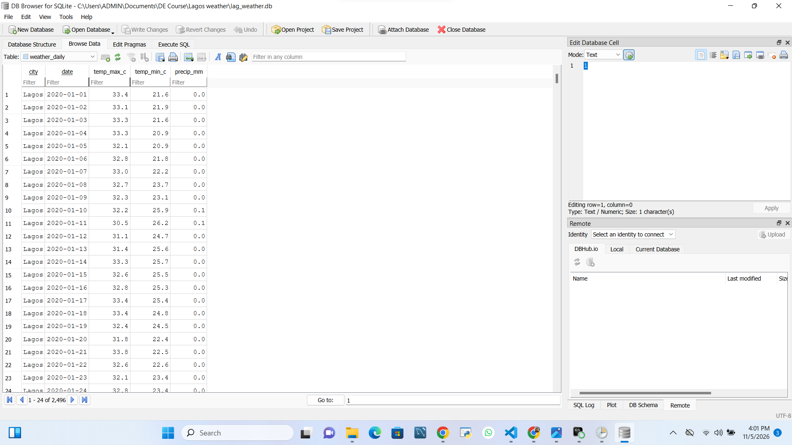
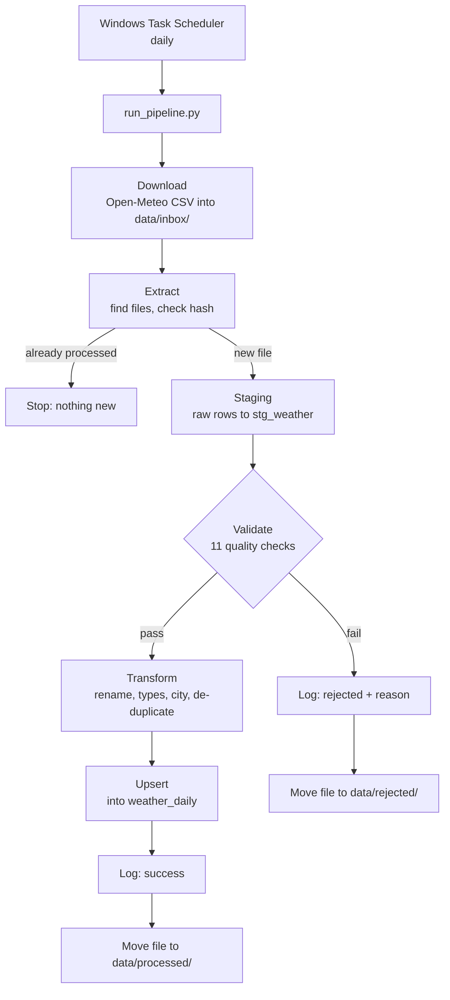

# Lagos Weather ETL Pipeline

An automated, end-to-end batch ETL pipeline that downloads daily weather data for Lagos, Nigeria from the Open-Meteo API, validates and cleans it, and loads it into a SQLite database ready for analysis. It runs unattended every day using Windows Task Scheduler.

**Built to demonstrate:** staging layers, data quality validation, idempotent loads (upserts), file hashing, run logging, scheduling, and unit testing.



---

## What it does

- Downloads Lagos daily weather (max temperature, min temperature, rainfall) from Open-Meteo as CSV
- Skips any file it has already processed, using a SHA-256 hash of the file contents
- Saves an untouched copy of the raw rows before any cleaning
- Runs 11 data quality checks and rejects files that fail
- Cleans and loads good files into a final table with an upsert, so re-running never creates duplicates
- Records every run (file, row counts, status, error) in a run log
- Files each CSV into `processed/` or `rejected/` as an audit trail

The result is one clean row per day, from 2020-01-01 to roughly five days before the latest run, ready for SQL, Python, Excel, or BI tools.

**Snapshot (2 November 2026):** `weather_daily` holds 2,493 rows, one for every day from 2020-01-01 to 2026-10-28 with no gaps and no duplicate dates. Daily maximum temperatures range from 25.3 to 34.9 °C and daily minimums go down to 18.7 °C.

---

## Architecture

The pipeline is a directed acyclic graph (DAG): each step runs only after the previous one finishes, and nothing loops back.



| Step | Module | What it does |
|---|---|---|
| Download | `src/download.py` | Fetches the latest 30-day window for Lagos into `data/inbox/` |
| Extract | `src/extract.py` | Finds new CSVs, hashes each file, skips ones already logged as successful |
| Staging | `src/load.py` | Appends raw rows to `stg_weather` with `source_file` and `loaded_at` |
| Validate | `src/validate.py` | Runs the quality checks and returns pass/fail per check |
| Transform | `src/transform.py` | Renames columns, converts dates, adds `city`, drops duplicates |
| Upsert | `src/load.py` | `INSERT ... ON CONFLICT (city, date) DO UPDATE` into `weather_daily` |
| Log | `src/load.py` | Writes one row per file per run to `etl_run_log` |
| Move file | `src/files.py` | Moves the CSV to `processed/` or `rejected/` |
| Orchestration | `run_pipeline.py` | Runs the steps in order, with logging and error handling |

---

## Tech stack

- **Python 3** for the pipeline code
- **Pandas** for reading and transforming CSVs
- **SQLAlchemy** for the database connection
- **SQLite** as the data store (a single local file, `lag_weather.db`)
- **SQL** for table definitions, upserts, and analysis queries
- **requests** for downloading from the API
- **pytest** for unit tests
- **Windows Task Scheduler** for daily automation
- **DB Browser for SQLite** (optional) for browsing the data

---

## Project structure

```
Lagos weather/
├── src/
│   ├── download.py        # fetch the latest CSV from Open-Meteo
│   ├── extract.py         # read CSVs, hash files, find new files
│   ├── validate.py        # data quality checks
│   ├── transform.py       # clean and standardise
│   ├── load.py            # create tables, staging load, upsert, run log
│   └── files.py           # move files to processed/ or rejected/
├── tests/
│   ├── test_transform.py  # 4 tests
│   └── test_validate.py   # 7 tests
├── data/
│   ├── inbox/             # new CSVs land here
│   ├── processed/         # files that loaded successfully
│   └── rejected/          # files that failed validation or crashed
├── logs/
│   └── pipeline.log       # step-by-step run log
├── run_pipeline.py        # entry point
├── run_pipeline.bat       # launcher used by Task Scheduler
├── Lagos_weather.ipynb    # step-by-step prototype notebook (see Known limitations)
├── Lagos_weather.csv      # original 2020-2024 download
└── lag_weather.db         # SQLite database (not committed)
```

---

## Database design

The database has three tables.

**`stg_weather`** holds the raw rows exactly as they arrived, plus `source_file` and `loaded_at`. Staging appends every file it receives, so overlapping download windows can repeat days here. That is expected: it is the raw record of what arrived.

**`weather_daily`** is the clean table analysts should query.

| Column | Type | Notes |
|---|---|---|
| `city` | TEXT | Part of the primary key |
| `date` | TEXT | ISO format `YYYY-MM-DD`, part of the primary key |
| `temp_max_c` | REAL | Daily maximum temperature, °C |
| `temp_min_c` | REAL | Daily minimum temperature, °C |
| `precip_mm` | REAL | Daily rainfall, mm |

Primary key: `(city, date)`, which makes loads idempotent.

**`etl_run_log`** is the pipeline's memory.

| Column | Notes |
|---|---|
| `run_id` | Auto-incrementing key |
| `file_name`, `file_hash` | Which file, and its content fingerprint |
| `rows_read`, `rows_loaded` | Volume checks |
| `status` | `success` or `rejected` |
| `error_message` | Failed checks or the crash message |
| `run_at` | Timestamp |

Example from this project's log, showing a rejected file, two daily runs, and a backfill:

| file_name | rows_read | rows_loaded | status | error_message |
|---|---|---|---|---|
| `Lagos_broken.csv` | 1827 | 0 | rejected | Failed checks: temp_max_range |
| `Lagos_weather_2026-10-18.csv` | 31 | 31 | success | |
| `Lagos_weather_2026-10-28.csv` | 31 | 31 | success | |
| `Lagos_weather_backfill.csv` | 701 | 701 | success | |

`Lagos_broken.csv` was a copy of the real file with one temperature changed to 99 °C, used to prove the rejection path works.

---

## Data quality checks

Every file must pass all 11 checks before any of it reaches `weather_daily`.

| Check | Rule |
|---|---|
| `schema` | Columns match the expected names, in order |
| `row_count` | At least one row |
| `no_nulls` | No missing values in any column |
| `valid_dates` | Every `time` value parses as a date |
| `unique_dates` | No date appears twice |
| `no_missing_days` | One row per day across the whole date range |
| `temp_max_range` | Max temperature between 15 and 45 °C |
| `temp_min_range` | Min temperature between 15 and 45 °C |
| `rain_range` | Rainfall is never negative |
| `max_gte_min` | Max temperature is never below min temperature |
| `no_future_dates` | No dates after today |

If any check fails, the file is logged as `rejected` with the failed check names, moved to `data/rejected/`, and nothing is loaded. A rejected file can be fixed and re-dropped into the inbox, because only successful files count as processed.

---

## Setup

**Requirements:** Python 3.10 or later.

```bash
git clone https://github.com/franklyndappah-alt/lagos-weather-etl-pipeline.git
cd lagos-weather-etl-pipeline
pip install pandas sqlalchemy requests pytest
```

## Run the pipeline

```bash
python run_pipeline.py
```

On the first run it creates `lag_weather.db` and the three tables, downloads the latest weather window, and processes it. Check `logs/pipeline.log` for the step-by-step output. If the inbox has nothing new, the log says `No new files in the inbox. Nothing to do.`

**File naming:** the city is read from the part of the file name before the first underscore (`Lagos_weather_2026-10-28.csv` becomes `Lagos`), so files placed in the inbox by hand should follow that pattern.

## Backfill history

The scheduled download only fetches the latest 31 days. To load older history, such as the original 2020-2024 file or a gap after downtime, drop a CSV into `data/inbox/` or download a longer window once:

```python
from src.download import download_lagos_csv

f = download_lagos_csv(days_back=700)          # about 701 days of history
f.replace(f.with_name("Lagos_weather_backfill.csv"))
```

Then run `python run_pipeline.py`. The rename matters: the daily download is saved as `Lagos_weather_<end-date>.csv`, so a backfill with the same name would be overwritten by the next daily download before the pipeline reads it. The upsert updates days already in the table and inserts the missing ones, so nothing is duplicated.

## Schedule it (Windows)

1. Edit `run_pipeline.bat` so the project folder and Python path match your machine:

   ```bat
   @echo off
   cd /d "C:\path\to\project"
   "C:\path\to\python.exe" run_pipeline.py
   ```

   The `cd` line matters because Task Scheduler does not start in the project folder by default.
2. Open **Task Scheduler**, then **Create Basic Task**.
3. Trigger: **Daily**. Action: **Start a program**, pointing to `run_pipeline.bat`, with **Start in** set to the project folder.
4. In the task's Properties, tick **Run task as soon as possible after a scheduled start is missed**, and untick **Start the task only if the computer is on AC power** if you use a laptop.

## Run the tests

```bash
python -m pytest
```

Expected: `11 passed`. The suite feeds the validator deliberately broken data (a null, a missing day, a duplicate date, an impossible temperature, max below min, a future date) and checks the right rule fails, and checks that clean data passes everything.

---

## Example queries

```sql
-- Latest 10 days
SELECT * FROM weather_daily ORDER BY date DESC LIMIT 10;

-- Average maximum temperature per month
SELECT substr(date, 1, 7) AS month, ROUND(AVG(temp_max_c), 1) AS avg_max_c
FROM weather_daily
GROUP BY month
ORDER BY month;

-- Rainiest 10 days
SELECT date, precip_mm FROM weather_daily ORDER BY precip_mm DESC LIMIT 10;

-- Total rainfall per year
SELECT substr(date, 1, 4) AS year, ROUND(SUM(precip_mm), 1) AS total_mm
FROM weather_daily
GROUP BY year
ORDER BY year;

-- Pipeline run history
SELECT run_id, file_name, rows_read, rows_loaded, status, error_message, run_at
FROM etl_run_log
ORDER BY run_id DESC;
```

To read the data in Python:

```python
import pandas as pd
from sqlalchemy import create_engine

engine = create_engine("sqlite:///lag_weather.db")
df = pd.read_sql("SELECT * FROM weather_daily", engine)
```

---

## Design decisions

- **Staging before cleaning:** raw data is saved first, so a bug in the transform never costs the original data.
- **Upserts instead of inserts:** re-running the pipeline, or loading overlapping windows, never duplicates a day.
- **File hashing:** files are recognised by content, not by name, so renamed copies are skipped and changed files are reprocessed.
- **Validation as a gate:** bad data is stopped before it reaches the clean table, and the reason is logged.
- **Only successes count as processed:** a rejected file can be corrected and retried.
- **Overlapping download windows:** each daily run downloads 31 days, so a few missed runs do not leave gaps.

## Known limitations

- **Data lag:** the archive endpoint trails real time by about 5 days, so today's readings arrive around five days later.
- **Single city:** the pipeline is built around Lagos, though the transform takes the city as a parameter.
- **SQLite allows one writer at a time:** do not keep the database open in a viewer while the scheduled run executes, and do not sync the live `.db` file through a cloud drive.
- **The notebook writes to the database:** `Lagos_weather.ipynb` was used to build the pipeline step by step, and some of its cells write to `lag_weather.db`. Use it as a reference and avoid Run All against a live database.
- **Windows-specific scheduling:** the `.bat` file and Task Scheduler setup are Windows only.

## Possible next steps

- Add more cities, or a second source such as NBS data
- Move from SQLite to Postgres and containerise with Docker
- Export a daily CSV for non-technical users
- Add failure alerts (email or Slack)
- Build a dashboard (Metabase or Streamlit) on top of `weather_daily`
- Replace the scheduler with Airflow

---

## Data source and licence

Weather data comes from the [Open-Meteo Historical Weather API](https://open-meteo.com/en/docs/historical-weather-api), which is based on ERA5 reanalysis data. Requests use the coordinates 6.5244 N, 3.3792 E, and Open-Meteo snaps them to the nearest grid cell (about 6.50 N, 3.40 E), so values are modelled for that cell and are not station measurements. Open-Meteo data is shared under CC BY 4.0, so please credit Open-Meteo if you reuse it.

## What I learned

- Why a staging layer protects raw data
- Designing validation rules for completeness, uniqueness, validity, range, consistency, and timeliness
- Making loads idempotent with primary keys and upserts
- Using file hashes to avoid reprocessing
- Logging every run and handling failures without stopping the pipeline
- Turning notebook prototypes into modular, testable scripts
- Automating a pipeline with Windows Task Scheduler
- Debugging real problems, such as a download overwriting a backfill file with the same name

## Author

**Franklyn Dappah**: [GitHub](https://github.com/franklyndappah-alt) 